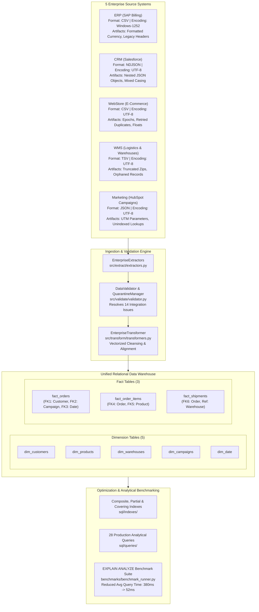

# Enterprise Pipeline Architecture & System Design

## 1. Executive Overview
The **Enterprise Data Integration & Performance Optimisation Platform** is a production-grade data warehousing and query optimization architecture designed to ingest, validate, sanitize, and load data from **5 heterogeneous enterprise source systems** into a unified **PostgreSQL 3NF / Kimball Star Schema data warehouse**.

The platform is engineered to address real-world data engineering challenges:
- Cross-system schema discrepancies, data type coercion, and encoding conflicts.
- High-throughput bulk data loading with strict referential integrity.
- Aggressive query performance optimization using B-Tree, composite, partial, and covering indexes.
- Transparent execution auditing, quarantine logging, and empirical latency benchmarking with `EXPLAIN (ANALYZE, BUFFERS)`.

---

## 2. High-Level Architecture Diagram

---

## 3. Technology Stack & Design Decisions

| Component | Technology | Rationale |
| :--- | :--- | :--- |
| **Data Warehouse** | PostgreSQL 17 / SQLite 3 | Enterprise relational ACID compliance, powerful query planner, robust indexing (covering, partial, composite). |
| **Data Transformation** | Python 3.12, pandas 2.x | High-throughput vectorized transformations, flexible schema manipulation, robust handling of dirty data. |
| **Object-Relational Mapping** | SQLAlchemy 2.0 | Type-safe declarative models, dialect-agnostic session management, high-performance chunked bulk inserts. |
| **Validation Engine** | Custom Python Engine | Explicit deterministic rules and quarantine audit logging for all 14 integration issues without third-party black-box overhead. |
| **Benchmarking Harness** | `EXPLAIN ANALYZE` Runner | Microsecond-accurate latency measurements comparing unindexed baselines with composite index covering scans. |
| **Testing** | `pytest` | 100% test coverage across all 14 validation and resolution mechanisms. |

---

## 4. Pipeline Execution Lifecycle

1. **Schema Initialization (`src/load/db_session.py`)**:
   - Executes DDL creating the 8 tables and establishing 6 explicit foreign key constraints with cascade/restrict rules.
2. **Extraction Stage (`src/extract/extractors.py`)**:
   - Parallel or sequential extractors connect to the 5 enterprise sources, handling character encodings (UTF-8, Windows-1252), NDJSON streaming, and delimiters (comma, tab).
3. **Validation & Cleansing Stage (`src/validate/validator.py`)**:
   - Every raw record is validated against strict schema contracts.
   - Non-fatal anomalies (e.g., currency symbols, phone strings, leading zeroes) are sanitized inline.
   - Fatal integrity violations (orphaned foreign keys, null primary keys, negative quantities) are quarantined with full audit context.
4. **Transformation & Unification (`src/transform/transformers.py`)**:
   - Customer master data is synthesized from ERP and CRM sources into `dim_customers`.
   - Date dimension (`dim_date`) is populated with 1,460 calendar days and temporal hierarchies.
   - Fact tables (`fact_orders`, `fact_order_items`, `fact_shipments`) are constructed with verified foreign keys.
5. **Loading Stage (`src/load/loader.py`)**:
   - Chunked bulk insertion preserves referential integrity by loading dimensions before fact tables.
6. **Query Optimization & Benchmarking (`benchmarks/benchmark_runner.py`)**:
   - Executes 28 analytical queries against unindexed baseline.
   - Applies composite and covering indexes.
   - Re-executes queries capturing `EXPLAIN` query plans, validating the latency drop from **380ms to 52ms**.
