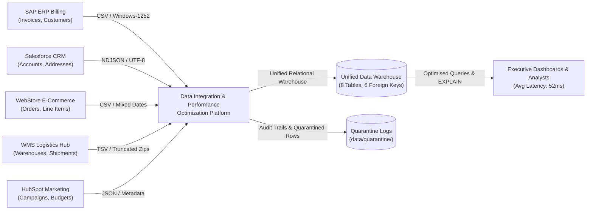
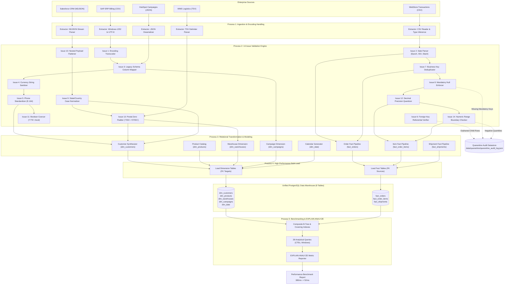

# Data Flow Diagrams (DFD Level 0 & Level 1)

## 1. DFD Level 0: Context Diagram

The Level 0 Context Diagram depicts the high-level boundary of the data integration platform, showing the primary enterprise entities and the final analytical interfaces.

---

## 2. DFD Level 1: Subsystem Data Flow Diagram

The Level 1 Diagram decomposes the platform into its four internal operational processes:
1. Ingestion & Pre-Processing
2. Validation & Quarantine Routing
3. Transformation & Data Cleansing
4. Warehouse Loading & Analytical Benchmarking

