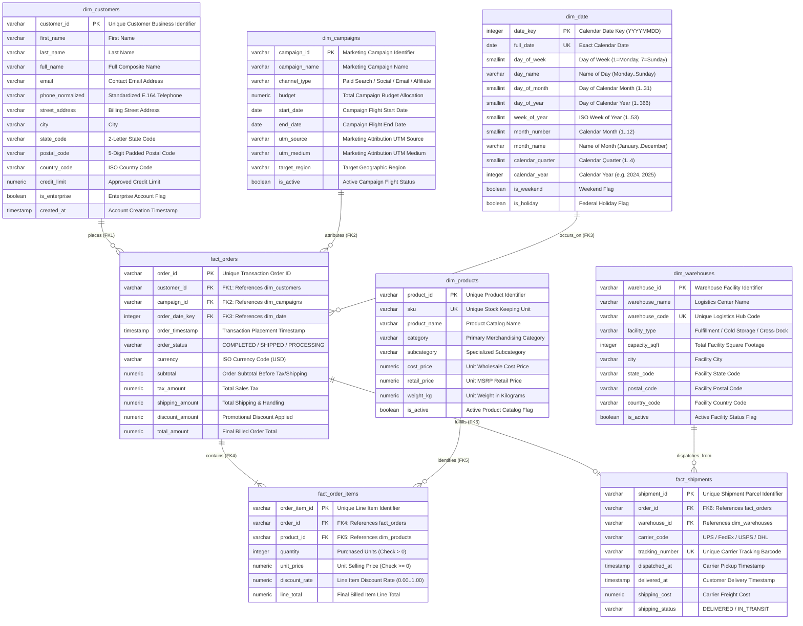

# Unified Data Model: Entity-Relationship Diagram (ERD)

## 1. Schema Specifications
- **Architecture**: Kimball Dimensional Star Schema / 3NF Warehouse Model
- **Total Tables**: 8 Tables (5 Dimension Tables, 3 Fact Tables)
- **Total Relational Foreign Keys**: 6 Primary Explicit Foreign Key Constraints
- **Database Engine**: PostgreSQL 17 (with dialect-compatible SQLite 3 mode)

---

## 2. Entity-Relationship Diagram (Mermaid)

---

## 3. Explicit Foreign Key Constraint Directory

| Constraint Name | Source Table | Constrained Column | Target Table | Referenced Column | Referential Action |
| :--- | :--- | :--- | :--- | :--- | :--- |
| **fk_orders_customer** (FK1) | `fact_orders` | `customer_id` | `dim_customers` | `customer_id` | `ON DELETE RESTRICT` |
| **fk_orders_campaign** (FK2) | `fact_orders` | `campaign_id` | `dim_campaigns` | `campaign_id` | `ON DELETE SET NULL` |
| **fk_orders_date** (FK3) | `fact_orders` | `order_date_key` | `dim_date` | `date_key` | `ON DELETE RESTRICT` |
| **fk_items_order** (FK4) | `fact_order_items` | `order_id` | `fact_orders` | `order_id` | `ON DELETE CASCADE` |
| **fk_items_product** (FK5) | `fact_order_items` | `product_id` | `dim_products` | `product_id` | `ON DELETE RESTRICT` |
| **fk_shipments_order** (FK6) | `fact_shipments` | `order_id` | `fact_orders` | `order_id` | `ON DELETE CASCADE` |
| **fk_shipments_warehouse** | `fact_shipments` | `warehouse_id` | `dim_warehouses` | `warehouse_id` | `ON DELETE RESTRICT` |
