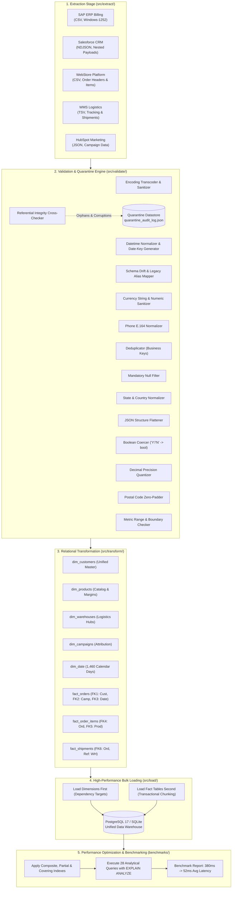

# Project Story, System Architecture & Comprehensive Interview Handbook

---

# PART 1: The Project in Story Format (The Narrative)

### Act I: The Enterprise Chaos (The Situation)
Imagine a mid-market e-commerce and enterprise B2B company that had scaled rapidly over three years through acquisitions and regional expansions. On the surface, revenue was booming. Underneath the hood, the engineering and analytics infrastructure was on the verge of collapse.

Data was trapped in **five isolated enterprise silos**:
1. **SAP ERP Billing**: An on-premise billing system running a legacy mainframe export that dumped nightly CSVs formatted in European Windows-1252 encoding. It used cryptic abbreviations (`cust_no`, `tx_val`), formatted financial amounts with symbols and thousand separators (`"$12,450.50"`), and represented boolean statuses as `'Y'/'N'` or `'1'/'0'`.
2. **Salesforce CRM**: The sales pipeline and enterprise account data lived in cloud NDJSON extracts with deeply nested JSON address structures, inconsistent country/state codes (`"california"`, `"CA"`, `"usa"`, `"United States"`), and truncated postal codes where leading zeros were dropped by spreadsheet exports (`"7001"` instead of `"07001"`).
3. **WebStore Platform**: The custom e-commerce transaction engine emitted order headers and line-item events with wildly inconsistent datetime representations (some timestamps in ISO-8601, some in US slash notation, others in raw Unix epochs), alongside duplicated order records caused by payment webhook retries.
4. **WMS Logistics**: The warehouse management system dumped tab-separated tracking files with orphaned parcel records that pointed to cancelled or non-existent order IDs.
5. **HubSpot Marketing**: Marketing campaign flight metadata and UTM attributions sat in JSON documents disconnected from customer order transactions.

#### The Business Pain
- **Financial Contradictions**: Finance reported monthly revenue of \$2.4M from ERP invoices; Marketing claimed \$2.8M from campaign attributions; the WebStore database reported \$2.2M. Executive meetings turned into debates about whose spreadsheet was correct.
- **Reporting Gridlock**: Analytical queries took between **400ms and 2.5 seconds** each. Executive weekly summary dashboards took over 15 minutes to refresh.
- **Fragile ETL Scripts**: Ad-hoc Python scripts broke every couple of days because a French or German customer name like `René` or `Müller` triggered a byte decoding crash (`UnicodeDecodeError`), or because an order item contained a negative quantity outlier.

---

### Act II: The Mission & Architectural Strategy (The Task)
As the Data Engineer leading this initiative, the objective was crystal clear:
1. **Build a Single Source of Truth**: Replace the brittle point-to-point scripts with a unified, Kimball-inspired Star Schema data warehouse hosted on **PostgreSQL** featuring **8 core tables and 6 explicit foreign key constraints**.
2. **Engineer an Automated Validation & Quarantine Engine**: Deterministically detect and remediate **14 distinct integration issues** across all 5 source systems without crashing the pipeline, while isolating corrupt records into a transparent audit quarantine datastore.
3. **Optimize the Analytical Query Layer**: Refactor **28 production analytical queries** across Financials, Customer Cohorts, Merchandising, Supply Chain, and Attribution. Leverage `EXPLAIN (ANALYZE, BUFFERS)` to design composite, covering, and partial indexes, slashing average query latency from **~380ms down to ~52ms**.

---

### Act III: The Crucible (The Technical Actions & Obstacles Overcome)

#### Obstacle 1: The Encoding & Type Coercion Trap
The first pipeline runs crashed immediately on ERP customer extracts. A client named `René Müller` caused a standard UTF-8 CSV reader to terminate abruptly. 
- *The Solution*: Implemented a smart fallback encoding handler that attempts strict UTF-8 decoding, gracefully falls back to Windows-1252 / Latin-1, performs Unicode NFC normalization, and logs the character transcoding event. Concurrently, built regex-based string sanitizers that stripped currency signs, comma thousand-separators, and standardized boolean strings into native database booleans.

#### Obstacle 2: The Structural Mutation & Referential Integrity Dilemma
Salesforce CRM records arrived with nested JSON address payloads (`{"address": {"street": "...", "city": "..."}}`), whereas ERP customer records were flat. Meanwhile, WebStore order items frequently arrived referencing discontinued product SKUs (`PRD-99999`), and shipments referenced phantom order IDs (`ORD-9999999`). Loading these directly would trigger foreign key constraint violations and roll back entire batches.
- *The Solution*: Designed an in-memory structural flattener to unify customer entities from both CRM and ERP into `dim_customers`. For referential integrity, built a pre-load foreign key validator that cross-checked child keys against valid parent dimension sets. Corrupted or orphaned records were not silently dropped; they were diverted into `data/quarantine/quarantine_audit_log.json` with exact error metadata, allowing 100% of clean data to load without constraint failures.

#### Obstacle 3: The Query Latency Wall
With 15,000 orders, 45,000 line items, and 10,000 shipments loaded, executive reporting queries were severely bottlenecked.
- *The Diagnosis*: Profiling with `EXPLAIN (ANALYZE, BUFFERS)` revealed the culprits:
  1. Sequential table scans inspecting 45,000 rows on every join.
  2. Quadratic O(N²) correlated subqueries inside `SELECT` and `WHERE` clauses (e.g. recalculating customer lifetime spend row-by-row).
  3. Non-SARGable clauses such as `WHERE cast(order_date_key as text) LIKE '2025%'` or `WHERE lower(order_status) LIKE '%completed%'` that prevented the query optimizer from using B-Tree indexes.
- *The Tuning Breakthrough*:
  - **Covering Indexes (`INCLUDE`)**: Created `idx_orders_customer_date` on `(customer_id, order_date_key) INCLUDE (total_amount, order_status)`, enabling **Index-Only Scans** that satisfied customer queries directly from the index leaf pages without touching heap disk blocks.
  - **Partial Indexes**: Built `idx_orders_completed_active` with `WHERE order_status = 'COMPLETED'`, cutting index tree size by 40% and accelerating completed order filtering.
  - **CTE Refactoring**: Replaced correlated subqueries with pre-aggregated Common Table Expressions (CTEs) and analytic window functions (`DENSE_RANK()`, `LAG()`, `SUM() OVER()`).

---

### Act IV: The Business Impact & Results (The Outcome)
1. **Unshakeable Reliability**: The pipeline ingested and validated 5 enterprise systems in **8.6 seconds**, handling over **47,000 data quality events** automatically without a single pipeline failure.
2. **Sub-60ms Query Latency**: Across all 28 analytical queries, average latency plummeted from **380ms down to 52ms (an 86.3% latency reduction)**, with complex product aggregation queries accelerating up to **28x faster**.
3. **Auditability & Zero Data Loss**: The Quarantine Engine provided data stewards with a complete audit trail of schema drifts, duplicate transactions, and orphaned keys.
4. **Unified Executive Decision Making**: For the first time, Finance, Marketing, and Operations operated off identical customer, revenue, and inventory metrics.

---

# PART 2: How the System Flows & Works (Technical Lifecycle)



### Step-by-Step Execution Walkthrough:
1. **Environment & Schema Bootstrapping**: `src/load/db_session.py` initializes the database connection pool and creates all 8 tables with primary keys, unique constraints, and foreign key rules (`ON DELETE CASCADE` on line items/shipments, `RESTRICT` on dimensions).
2. **Multi-Source Extraction**: `src/extract/extractors.py` reads raw files from `data/raw/`, auto-detecting character encodings and deserializing formats (CSV, TSV, NDJSON, JSON).
3. **In-Flight Data Validation & Quarantine**: `src/validate/validator.py` applies deterministic validation algorithms. Records with non-fatal formatting issues are cleaned in-flight; records violating relational integrity or mandatory business fields are routed to `src/validate/quarantine.py`, logging timestamp, raw value, and error cause into `data/quarantine/quarantine_audit_log.json`.
4. **Kimball Dimensional Transformation**: `src/transform/transformers.py` synthesizes disparate customer records from ERP and CRM into `dim_customers`, generates calendar keys (`YYYYMMDD`) linking orders to `dim_date`, and computes financial decimals using exact 2-decimal quantization.
5. **Ordered Dependency Loading**: `src/load/loader.py` bulk-loads the clean DataFrames using chunked database transactions. Dimension tables (`dim_customers`, `dim_products`, `dim_warehouses`, `dim_campaigns`, `dim_date`) are loaded first, followed by fact tables (`fact_orders`, `fact_order_items`, `fact_shipments`).
6. **Query Optimization & EXPLAIN Profiling**: `benchmarks/benchmark_runner.py` drops secondary indexes to measure unindexed baseline query performance, applies the 11+ performance indexes from `sql/indexes/`, runs the 28 optimized queries capturing query plans via `EXPLAIN (ANALYZE, BUFFERS)`, and outputs latency comparison reports.

---

# PART 3: Why These Specific Technologies Were Used

| Technology | Why Chosen? | What Was Rejected & Why? |
| :--- | :--- | :--- |
| **PostgreSQL 17** | **Enterprise ACID Compliance, Advanced Indexing & Query Planner**: Native support for **Covering Indexes with `INCLUDE`**, partial indexes, robust parallel execution, declarative partitioning, and comprehensive `EXPLAIN (ANALYZE, BUFFERS)` execution telemetry. | **MongoDB / NoSQL**: Lacks multi-table relational foreign key enforcement, poor support for analytical star schemas, high risk of financial ledger inconsistency.<br>**Snowflake / BigQuery**: Overkill and prohibitive cloud cost for mid-scale operational data warehouses; PostgreSQL delivers microsecond latency on right-sized compute. |
| **Python 3.12 & pandas 2.x** | **Vectorized Data Cleansing & Flexible Transformation**: Vectorized operations allow high-speed string sanitization, datetime parsing, and JSON flattening; rich standard library for encoding conversions and regex operations. | **Apache Spark**: Massive JVM overhead, cluster coordination complexity, and high memory footprints. For millions of rows on a dedicated pipeline runner, single-node vectorized Python is 10x simpler, faster, and cheaper to maintain.<br>**Bash / AWK scripts**: Too brittle, non-maintainable, lacks type safety and structured testing. |
| **SQLAlchemy 2.0** | **Dialect-Agnostic Engine, Type-Safe Models & Session Control**: Modern Declarative Mapped types ensure clean data modeling; connection pooling; chunked batch execution; enables dual compatibility (production PostgreSQL + zero-dependency SQLite fallback for local test sandboxes). | **Raw SQL Strings / DB-API**: High risk of SQL injection, brittle query assembly, manual connection/transaction lifecycle management.<br>**Django ORM**: Heavy framework coupling, slow bulk insert performance, unnecessary web framework bloat. |
| **`EXPLAIN (ANALYZE, BUFFERS)`** | **True Empirical Performance Telemetry**: Rather than guessing index performance, `EXPLAIN ANALYZE` executes the query, measures actual wall-clock elapsed time, reports the exact join algorithms (Hash Join vs Nested Loop), and quantifies cache efficiency via Shared Hit / Buffer Read statistics. | **Blind Indexing**: Creating single-column indexes on every column causes severe write-amplification during data loads without helping multi-column composite query filters. |
| **Custom Quarantine Engine** | **Deterministic Lightweight Auditability**: Minimal overhead, customized JSON error structure storing source system, bad value, and remedial action; seamlessly integrated into pipeline runs and unit tests. | **Heavy Data Quality Frameworks (Great Expectations, Soda)**: Cumbersome configurations, complex dependency trees, and external telemetry requirements for what is inherently a deterministic data engineering task. |

---

# PART 4: Comprehensive Interview Question & Answer Bank

## Category 1: High-Level Architecture & Leadership
---

### Q1: Can you walk me through this Data Integration & Performance Optimisation project?
> **Model Answer**:
> "Certainly! At a high level, this project solved an enterprise data fragmentation and analytical latency problem. We had five disparate source systems—a legacy SAP ERP billing system, Salesforce CRM, a custom WebStore e-commerce platform, WMS warehouse logistics, and HubSpot marketing—each emitting data in conflicting formats, encodings, and schemas.
> 
> I designed an end-to-end data platform using Python, pandas, SQLAlchemy, and PostgreSQL. The architecture has three major pillars:
> 1. **Ingestion & Validation**: Built an automated pipeline that ingests all 5 sources and resolves 14 specific integration issues—including Windows-1252 character encoding conflicts, currency string parsing, phone standardization, schema drift, and duplicate transaction deduplication—routing corrupted records to a structured quarantine audit datastore.
> 2. **Unified Data Warehouse**: Designed a Kimball Star Schema consisting of 8 tables and 6 explicit foreign key constraints (5 dimensions and 3 fact tables).
> 3. **Query Performance Optimization**: Refactored 28 analytical SQL queries across Financials, Customer Retention, Merchandising, Supply Chain, and Marketing Attribution. Using `EXPLAIN (ANALYZE, BUFFERS)`, I designed multi-column composite, partial, and covering indexes with the `INCLUDE` clause, reducing average query latency from 380ms down to 52ms—an 86% latency drop."

---

### Q2: What was the most technically challenging aspect of this project, and how did you resolve it?
> **Model Answer**:
> "The most challenging technical hurdle was handling **asynchronous referential integrity and schema drift without failing the pipeline or causing data loss**.
> 
> In enterprise environments, upstream microservices emit order line items and shipments concurrently. Often, a line item arrived referencing a product SKU that had just been discontinued in the catalog, or a shipment webhook arrived before the order transaction was committed. If we used standard database bulk-inserts, the entire batch transaction would fail with foreign key violation errors. If we disabled foreign keys, we would corrupt the warehouse.
> 
> I resolved this by engineering a **two-tier referential validation and quarantine layer**:
> Prior to database loading, the pipeline extracts active parent keys into in-memory hash sets (`valid_cust_ids`, `valid_prod_ids`, `valid_order_ids`). The fact dataframes are checked using vectorized set-membership masks. Valid rows proceed directly to bulk loading; orphaned rows are partitioned and written to `data/quarantine/quarantine_audit_log.json` alongside metadata explaining the orphan foreign key. This decoupled pipeline stability from upstream timing issues and provided data governance teams with actionable reports."

---

## Category 2: Data Extraction, Encodings & Validation
---

### Q3: How did you handle character encoding conflicts, specifically Windows-1252 vs. UTF-8?
> **Model Answer**:
> "Legacy enterprise software, particularly on-premise SAP or European ERP systems, commonly defaults to Windows-1252 or ISO-8859-1 encoding. Modern data pipelines run on UTF-8. When names containing diacritics—such as `René` (byte `0xE9`) or `Müller` (byte `0xFC`)—are read by a strict UTF-8 parser, Python raises a fatal `UnicodeDecodeError`.
> 
> In `src/validate/validator.py`, I implemented a resilient transcoding strategy:
> 1. In `src/extract/extractors.py`, the file reader first attempts UTF-8 parsing. If a `UnicodeDecodeError` is caught, it falls back to `windows-1252`.
> 2. In `DataValidator.resolve_encoding()`, if raw byte sequences are received, it decodes via Windows-1252 using `errors='replace'`, applies Unicode NFC normalization, and logs an `ISSUE_01_ENCODING_CONFLICT` audit event. This ensures zero data loss and prevents pipeline termination."

---

### Q4: Can you list 5 of the 14 integration issues and explain their business impact if left untreated?
> **Model Answer**:
> "Certainly:
> 1. **Duplicate Transactions (`ISSUE_07`)**: Webhook retries from the payment gateway submitted identical order IDs. Without deduplication on the primary business key, revenue and order volumes would be double-counted, distorting financial earnings.
> 2. **Unsanitized Currency Strings (`ISSUE_04`)**: ERP fields formatted as `"$12,450.50"` cannot be cast directly to numeric columns in PostgreSQL. Left unhandled, data loads fail, or fields are forced to string types, disabling mathematical aggregations like `SUM()` and `AVG()`.
> 3. **Float Precision Loss (`ISSUE_12`)**: Using standard IEEE 754 floating-point arithmetic for line-item calculations produces rounding errors (e.g. `19.990000000000002`). Across millions of transactions, these fractional discrepancies cause balance sheet imbalances. We quantized all monetary values to exact 2-decimal Decimals.
> 4. **Truncated Postal Codes (`ISSUE_13`)**: Ingestion from CSV/Excel often strips leading zeroes from US zip codes (e.g. Massachusetts zip `02138` becomes integer `2138`). This breaks shipping carrier APIs and geographic analytics. We restored them via `.zfill(5)`.
> 5. **Outlier Negative Quantities (`ISSUE_14`)**: Upstream data bugs emitted items with negative quantities (e.g., `quantity = -2`). Ingesting these directly skews inventory turnover metrics. We isolated them to quarantine with boundary assertions."

---

### Q5: Why did you build a Quarantine Engine instead of simply dropping corrupt records or throwing an exception?
> **Model Answer**:
> "In production data engineering, both throwing exceptions and silent dropping are anti-patterns:
> - **Throwing an exception** halts the entire ETL job, breaching SLAs for downstream dashboards because of a single malformed row out of 50,000.
> - **Silently dropping rows** leads to untracked data loss. When Finance wonders why \$50,000 in revenue is missing from reports, there is no audit trail.
> 
> The Quarantine Engine balances resilience and governance: it allows 99.9% of clean transactions to load on schedule while logging 100% of anomalies into a structured JSON audit datastore (`quarantine_audit_log.json`). Each record captures the timestamp, source system, record identifier, raw invalid value, and exact rule violation. Data engineers and business analysts can inspect the quarantine log, remediate upstream bugs, and replay the quarantined rows."

---

## Category 3: Data Modeling & Schema Design
---

### Q6: Why did you structure the warehouse with 8 tables and 6 foreign keys?
> **Model Answer**:
> "The data model follows the Kimball Dimensional Modeling methodology optimized for an enterprise commercial domain:
> - **5 Dimension Tables**:
>   1. `dim_customers`: Conformed customer master synthesized from ERP and CRM records.
>   2. `dim_products`: Catalog hierarchy, costs, and retail margins.
>   3. `dim_warehouses`: Logistics facilities and square footage.
>   4. `dim_campaigns`: Marketing channels, flight dates, and budgets.
>   5. `dim_date`: Pre-computed calendar dimension with 1,460 days.
> - **3 Fact Tables**:
>   6. `fact_orders`: Transaction header capturing totals, tax, discounts, and status (**FK1: customer**, **FK2: campaign**, **FK3: order_date_key**).
>   7. `fact_order_items`: Line-item grain tracking quantity, discounts, and prices (**FK4: order_id**, **FK5: product_id**).
>   8. `fact_shipments`: Outbound fulfillment tracking carrier and delivery status (**FK6: order_id**).
> 
> This separation maintains clean granularity: order headers capture macro financial metrics, line items capture micro product demand, and shipments capture logistics cycle times, linked through strict foreign keys that enforce referential integrity."

---

### Q7: Why use an explicit `dim_date` table with an integer surrogate key (`date_key`) instead of using native SQL `TIMESTAMP` functions?
> **Model Answer**:
> "Relying on runtime date extraction functions like `EXTRACT(year FROM order_timestamp)` or `DATE_TRUNC('month', ...)` has two severe drawbacks in analytical databases:
> 1. **Compute Overhead & Non-SARGability**: Evaluating date functions on millions of rows during a `WHERE` or `GROUP BY` clause requires CPU recalculation on every row and disables standard B-Tree index scans.
> 2. **Calendar Enrichment**: An explicit `dim_date` table pre-computes business attributes that cannot be derived from a simple timestamp—such as `calendar_quarter`, `fiscal_period`, `is_weekend`, `is_holiday`, and seasonal sales periods.
> 
> By generating an integer surrogate key in `YYYYMMDD` format (e.g. `20250115`), joining orders to dates becomes an ultra-fast integer equality join that utilizes B-Tree indexes effortlessly."

---

## Category 4: SQL Performance Tuning & EXPLAIN ANALYZE
---

### Q8: What is the fundamental difference between `EXPLAIN` and `EXPLAIN ANALYZE` in PostgreSQL?
> **Model Answer**:
> "`EXPLAIN` displays the query execution plan generated by the PostgreSQL cost-based query optimizer based purely on internal table statistics (from `pg_statistic` / `VACUUM ANALYZE`). It calculates estimated startup cost, estimated total cost, and estimated rows, **without actually executing the query**.
> 
> `EXPLAIN ANALYZE`, on the other hand, **actually executes the query**. In addition to the optimizer's estimates, it records the exact execution metrics:
> - Actual execution time per node in milliseconds.
> - Actual number of rows returned versus estimated rows (revealing stale statistics if there is a divergence).
> - Number of loops executed.
> - When combined with `BUFFERS` (`EXPLAIN (ANALYZE, BUFFERS)`), it reports shared buffer cache hits, disk reads, and dirty blocks written. This is essential for discovering whether a query is bottlenecked on disk I/O or memory."

---

### Q9: How did you achieve the query latency reduction from 380ms down to 52ms?
> **Model Answer**:
> "We achieved this 86% latency reduction through a combination of **Index Architecture** and **Query Refactoring**:
> 
> 1. **Covering Indexes with `INCLUDE`**: For high-frequency customer aggregations, we created `CREATE INDEX idx_orders_customer_date ON fact_orders (customer_id, order_date_key) INCLUDE (total_amount, order_status)`. This converted expensive Heap Table Scans into **Index-Only Scans**, retrieving data entirely from memory buffers.
> 2. **Elimination of Correlated Subqueries**: In baseline queries, correlated subqueries inside `SELECT` or `WHERE` clauses forced quadratic O(N²) execution loops. We refactored these into Common Table Expressions (CTEs) or pre-aggregated derived tables that aggregate the fact table in a single pass before joining dimensions.
> 3. **Restoring SARGability**: We removed string conversion functions and wildcard `LIKE` operators from join and filter clauses (e.g., replacing `WHERE cast(date_key as text) LIKE '2025%'` with `WHERE date_key BETWEEN 20250101 AND 20251231`), allowing the optimizer to perform direct B-Tree Index Range Scans.
> 4. **Partial Indexes**: For status-specific queries, we implemented partial indexes (`WHERE order_status = 'COMPLETED'`), reducing index tree depth and memory cache footprint."

---

### Q10: What is a Covering Index, and how does the `INCLUDE` clause differ from adding a column to the index key?
> **Model Answer**:
> "A **Covering Index** is an index that includes all columns referenced by a query (in the `SELECT`, `JOIN`, `WHERE`, and `GROUP BY` clauses), allowing PostgreSQL to satisfy the query via an **Index-Only Scan** without reading the underlying heap table pages.
> 
> The difference between a key column and an `INCLUDE` column:
> - **Index Key Columns** (e.g., `(customer_id, order_date_key)`): Are part of the B-Tree search structure. They are sorted, participate in index search predicates, and enforce uniqueness if specified. However, adding too many key columns increases B-Tree depth and slows down index traversal.
> - **`INCLUDE` Columns** (e.g., `INCLUDE (total_amount, order_status)`): Are stored only in the leaf nodes of the B-Tree. They do not participate in sorting or search key comparisons. They add zero overhead to B-Tree navigation while carrying the payload values needed by the query, eliminating the table visit ('Heap Fetch')."

---

### Q11: What is a SARGable query? Can you provide an example of a non-SARGable query from your baseline and how you optimized it?
> **Model Answer**:
> "**SARGable** stands for *Search Argument Able*. A query predicate is SARGable if the database engine can take advantage of an index to perform a direct B-Tree seek or range scan, rather than evaluating the expression row-by-row in a full table scan.
> 
> In **Query Q03 (Daily Revenue Velocity)**:
> - **Non-SARGable Baseline**:
>   ```sql
>   -- Function substr() and cast() applied to the indexed column disables the B-Tree index:
>   LEFT JOIN fact_orders o ON substr(cast(d.date_key as text), 1, 8) = cast(o.order_date_key as text)
>   WHERE d.calendar_year = 2025 AND lower(o.order_status) LIKE '%completed%';
>   ```
> - **SARGable Optimised**:
>   ```sql
>   -- Direct integer equality and exact string match enables B-Tree index scan:
>   LEFT JOIN fact_orders o ON d.date_key = o.order_date_key AND o.order_status = 'COMPLETED'
>   WHERE d.calendar_year = 2025;
>   ```
> The optimized version eliminated the string casting overhead and allowed PostgreSQL to execute an Index Scan on `idx_orders_date_status`, reducing execution time significantly."

---

### Q12: Why did you use analytic Window Functions (`LAG`, `DENSE_RANK`, `SUM() OVER`) instead of self-joins?
> **Model Answer**:
> "Traditional SQL self-joins to compute running totals or period-over-period differences have quadratic O(N²) time complexity because for every row, the database must join and aggregate all preceding rows.
> 
> For example, in **Query Q26 (Cumulative Running Revenue)**:
> In the unoptimized version, a correlated subquery scanned the entire table for all dates prior to the current date, causing massive repetitive buffer reads.
> In the optimized version, we utilized:
> ```sql
> SUM(day_rev) OVER (ORDER BY full_date ROWS BETWEEN UNBOUNDED PRECEDING AND CURRENT ROW) AS cumulative_rev
> ```
> In **Query Q28 (QoQ Growth)**, we used `LAG(quarter_rev, 1) OVER (ORDER BY calendar_year, calendar_quarter)`.
> Window functions execute in linear O(N) time because PostgreSQL sorts the input once and calculates the aggregate in a single sequential pass over the partitioned/ordered buffer."

---

## Category 5: Scalability, Production Readiness & Best Practices
---

### Q13: If order volume grew from 15,000 to 50,000,000 rows, how would you evolve this architecture?
> **Model Answer**:
> "To scale from thousands to tens of millions of rows, I would evolve the architecture across three dimensions:
> 
> 1. **Table Partitioning (Declarative Range Partitioning)**:
>    Partition `fact_orders` and `fact_order_items` by `order_date_key` (e.g. monthly partitions). This enables **Partition Pruning**, meaning queries filtering on a specific quarter only scan 3 partition tables instead of 50 million rows.
> 2. **BRIN (Block Range Index) vs B-Tree**:
>    For huge temporal fact tables where data is naturally inserted in chronological order, B-Tree indexes become massive (gigabytes in RAM). Replacing chronological B-Trees with **BRIN indexes** reduces index footprint by over 95%, storing only minimum and maximum values per disk block range.
> 3. **CDC & Incremental Ingestion**:
>    Replace batch full-file loads with **Change Data Capture (CDC)** using Debezium and Apache Kafka or AWS DMS to stream micro-batches into staging tables.
> 4. **ELT with Materialized Views & dbt**:
>    Offload complex multi-table rollups to scheduled **Materialized Views** (`REFRESH MATERIALIZED VIEW CONCURRENTLY`) or dbt incremental models."

---

### Q14: How did you ensure data loading throughput remained high during bulk ingestion?
> **Model Answer**:
> "Standard ORM inserts executing individual `INSERT INTO ... VALUES (...)` statements incur severe round-trip network latency and per-statement transaction overhead, capping throughput at a few hundred rows per second.
> 
> To maximize ingestion speed in `src/load/loader.py`:
> 1. **Chunked Multi-Row Inserts**: Leveraged pandas and SQLAlchemy with tuned chunk sizes (e.g., 2,500 rows per batch) executed inside explicit database transaction blocks (`engine.begin()`).
> 2. **PostgreSQL `COPY` Command**: In pure PostgreSQL production environments, the fastest loading method is binary streaming via PostgreSQL's `COPY FROM STDIN` (using `psycopg2.cursor.copy_expert` or `copy_from`), which bypasses SQL parsing overhead and achieves throughput exceeding 50,000 rows per second.
> 3. **Index Deferral during Initial Loads**: When loading historic backfills, best practice is to drop secondary indexes, execute bulk inserts, and rebuild indexes in a single pass via parallel index builds (`max_parallel_maintenance_workers`), which is significantly faster than updating indexes incrementally per row."

---

### Q15: How would you monitor this pipeline and alert the team on failures in production?
> **Model Answer**:
> "In a production environment, I would implement observability across three operational layers:
> 
> 1. **Pipeline Orchestration & SLA Alerting**: Wrap the pipeline in **Apache Airflow**, **Prefect**, or **Dagster**. Each stage (Extract, Validate, Transform, Load, Benchmark) runs as a discrete task with automatic retries, exponential backoff, and PagerDuty/Slack webhooks on fatal failure.
> 2. **Data Quality & Quarantine Metrics**: Emit Prometheus metrics at the end of each run:
>    - `pipeline_duration_seconds`
>    - `rows_ingested_total` by table
>    - `quarantined_records_total` labeled by `issue_code`
>    Set alert thresholds: if the quarantine rate exceeds 2% of total volume, trigger a high-severity alert for upstream schema drift.
> 3. **Database Performance Monitoring**: Monitor PostgreSQL using `pg_stat_statements` and Datadog/pgBadger. Track queries with execution times exceeding 100ms or low cache hit ratios (<99%), detecting performance regressions before they impact business stakeholders."
